# Bahrd · atendimento de eventos de frota com IA

## 🎥 Vídeos de apresentação

- [Etapa 1](https://youtu.be/NSaoHzc8wSc)
- [Etapa 2](https://youtu.be/_jKgJpvK4Uk)
- [Etapa 3 · pitch](https://youtu.be/17FkGyW1TUE) · [demo de backup](https://youtu.be/T2_yCvMEiEE)

Quando um veículo monitorado dispara um alerta, alguém precisa descobrir se é
problema de verdade. Hoje esse alguém é uma pessoa, lendo e digitando. Este
sistema atende no lugar dela o que consegue confirmar sozinho — e chama a
pessoa quando o caso exige julgamento, autoridade ou tem risco.

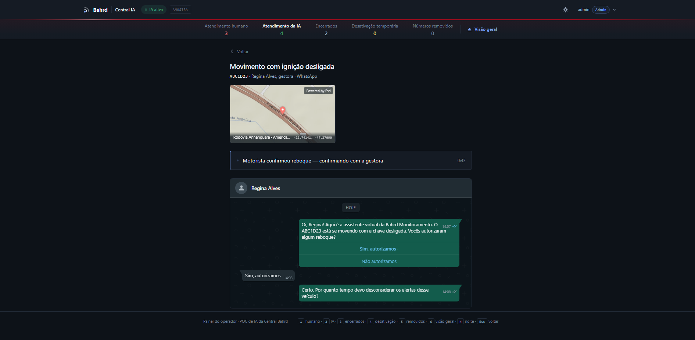

> ### ⚠️ Projeto acadêmico · empresa e dados fictícios
>
> A **Bahrd Monitoramento** não existe. É uma empresa fictícia criada para a
> disciplina *AI Factory: Build, Deploy and Showcase* (PUCPR), assim como a
> **Vetor**, fornecedora da URA legada citada na documentação.
>
> **Todo dado neste repositório é sintético e inventado** — telefones, placas,
> nomes, endereços, coordenadas, IMEIs e identificadores de conta. Nenhum
> corresponde a pessoa, veículo, empresa ou conta real, e nada aqui provém de
> cliente, operação ou sistema de terceiro.

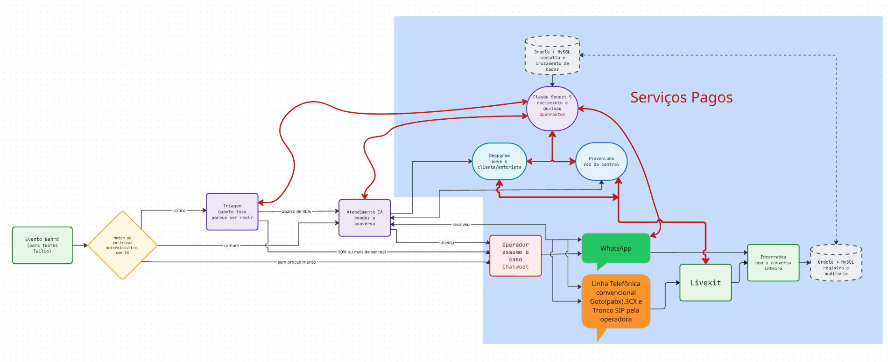

A cor diz o papel de cada peça. **A área azul é o que tem custo por uso**, e o
tracejado é o que ainda não está no ar.

Três coisas que o desenho decide:

**O motor de políticas roda antes de qualquer IA.** Ele é determinístico, e é
ele que manda o caso para a triagem, para o atendimento ou direto para uma
pessoa. Nenhum modelo participa dessa escolha.

**A triagem existe só para evento crítico**, e a régua é 90%: acima disso o caso
é de gente, sem conversa. Abaixo, a IA atende.

**O banco está tracejado porque ainda não foi ligado.** Oracle e MySQL estão no
ar e respondem à sonda, mas a aplicação ainda não grava ocorrência nem conversa
neles. A conversa em andamento sobrevive a um reinício, guardada no Redis
([ADR-003](docs/adr/0003-sessoes-fora-da-memoria.md)); o histórico de encerrados
e os números da Visão geral, não. Ver **Limitações conhecidas**, abaixo.

---

## Entregáveis da Etapa 1

| Pedido | Onde está |
|---|---|
| Auditoria do protótipo — lacunas encontradas antes de mexer | [docs/auditoria-prototipo.md](docs/auditoria-prototipo.md) |
| Matriz de decisão de stack — critérios, pesos e notas | [docs/decisao-stack.md](docs/decisao-stack.md) |
| ADR-001 (MADR) — escolha de stack, alternativas descartadas e o porquê | [docs/adr/0001-stack.md](docs/adr/0001-stack.md) |
| ADR-002 (MADR) — onde o projeto é publicado | [docs/adr/0002-plataforma-de-publicacao.md](docs/adr/0002-plataforma-de-publicacao.md) |
| Diagrama C4 — nível 1 (contexto) e nível 2 (containers) | [nível 1](docs/architecture/c4-nivel-1-contexto.md) · [nível 2](docs/architecture/c4-nivel-2-containers.md) |
| Ambientes de dev e produção separados, com secrets diferentes em cada um | Seção **URL pública**, logo abaixo — máquina, banco e credencial próprios em cada um |
| Rollback testado, com evidência de execução | Seção **Rollback**, logo abaixo — print e log, 33-37s, 3/3 smoke tests depois |
| Post-mortem leve, um incidente, uma página, sem apontar culpados | [Post-mortem 03](docs/post-mortem-03-dependencia-sem-teto.md) — os dois mais longos, com vários incidentes cada, estão na seção **Documentação**, logo abaixo |
| Vídeo de demonstração | [youtu.be/NSaoHzc8wSc](https://youtu.be/NSaoHzc8wSc) |

## Entregáveis da Etapa 2

| Pedido | Onde está |
|---|---|
| Trio sagrado (.env, .gitignore, .env.example) com secrets por ambiente | `.env.prod.example` · seção **Separação de ambientes**, abaixo |
| Rotação de credenciais, documentada | [docs/rotacao-de-credenciais.md](docs/rotacao-de-credenciais.md) — com evidência real, não simulada |
| Mapa de dados pessoais, com base legal de cada coleta | [docs/mapa-dados-pessoais.md](docs/mapa-dados-pessoais.md) |
| Retenção e exclusão, com mecanismo real | [docs/retencao-e-exclusao.md](docs/retencao-e-exclusao.md) — [`workers/retencao.py`](src/central_ia/workers/retencao.py), job diário |
| Sanitização de PII antes do LLM | [`agent/pseudonimizacao.py`](src/central_ia/agent/pseudonimizacao.py) — detalhado em [docs/mapa-dados-pessoais.md](docs/mapa-dados-pessoais.md) |
| 5 métricas essenciais + alerta configurado + dashboard no README | Seção **Observabilidade**, abaixo |
| Uma otimização medida, com número antes e depois | Seção **Otimização medida**, logo abaixo |
| README v1.0 (LGPD, observabilidade, otimizações, troubleshooting) | As quatro seções homônimas, abaixo |
| Vídeo de demonstração (Etapa 2) | [youtu.be/_jKgJpvK4Uk](https://youtu.be/_jKgJpvK4Uk) |

## Entregáveis da Etapa 3

| Pedido | Onde está |
|---|---|
| Aplicação no ar e estável, com credenciais de teste | [bahrd.duckdns.org](https://bahrd.duckdns.org) · login com os perfis admin e operador, com as senhas na mensagem de entrega |
| Janela de uptime documentada | Seção **Janela de uptime**, abaixo, com os prints · [docs/evidencias/uptime-2026-11-05.md](docs/evidencias/uptime-2026-11-05.md) — 25h, 600 verificações a cada 5 minutos nos dois ambientes, nenhuma falha · UptimeRobot com 100% nas últimas 24h ([página pública](https://stats.uptimerobot.com/T0wcfHdkAq)) · `docker ps` com 26h sem reinício |
| README v1.0 profissional, com capturas de tela | Este arquivo · seção **Telas**, abaixo |
| Vídeo de pitch | [youtu.be/17FkGyW1TUE](https://youtu.be/17FkGyW1TUE) |
| Demo gravada de backup | [youtu.be/T2_yCvMEiEE](https://youtu.be/T2_yCvMEiEE) |
| One-pager executivo | [docs/one-pager-bahrd-ia.pdf](docs/one-pager-bahrd-ia.pdf) |
| Análise crítica | Entregue no AVA |

---

## O problema

A Bahrd Monitoramento faz rastreamento e monitoramento de veículos (carros,
motos, caminhões) e até de pessoas. Quando um evento dispara —
bateria removida, movimento sem ignição, botão de pânico — o cliente recebe uma
notificação por WhatsApp. A regra atual é simples e cara:

```
notificação enviada
  ├─ cliente NÃO responde  →  evento fecha, zero trabalho humano
  └─ cliente RESPONDE      →  SEMPRE cai para um operador
```

Não há filtro de complexidade. Qualquer resposta vira toque humano, mesmo
*"tá em manutenção"*. São cerca de **43 mil eventos por mês**, dos quais
**8 mil viram tratativa manual** — e a maior parte dessas não é conversa
difícil: é o operador lendo o retorno do cliente e digitando na placa do
veículo.

**O trabalho que sobra é digitação, não conversa.** É exatamente o que este
sistema faz de ponta a ponta.

## A solução

O evento entra, o motor de políticas decide o caminho, e a IA conversa pelo
canal que o cliente já usa — texto ou áudio de WhatsApp. Ela confirma a causa,
registra o desfecho e encerra. Quando não consegue, para e passa o caso adiante
com o histórico inteiro.

O que a torna utilizável sem alguém olhando por cima:

| | |
|---|---|
| **Desfecho fechado** | A IA só conclui o que a política daquele evento autoriza. Não existe desfecho livre. |
| **Blindagem de saída** | Toda resposta passa por um filtro antes de sair: sem link, sem exceder o teto de caracteres, sem repassar instrução de sistema. |
| **Trilha de auditoria** | Política aplicada, versão do prompt, evidência da triagem e custo ficam registrados por ocorrência. |
| **Escalonamento explícito** | Pânico, coação e pedido de humano param a IA. Não é sugestão do modelo: é regra do domínio. |

## Telas

Capturas da produção, na versão `1.4.0`, com os dados de amostra.

| | |
|---|---|
| 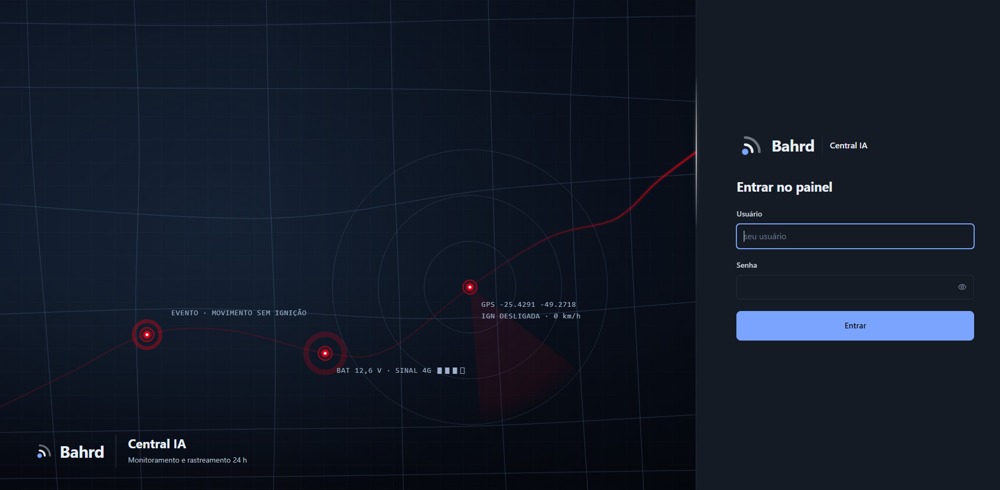 | 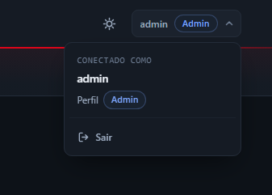 |
| **Entrada.** Login com dois perfis: admin vê tudo, operador não vê testes nem métricas. | **Menu do usuário.** Quem está conectado, com qual perfil, e a saída. |
| 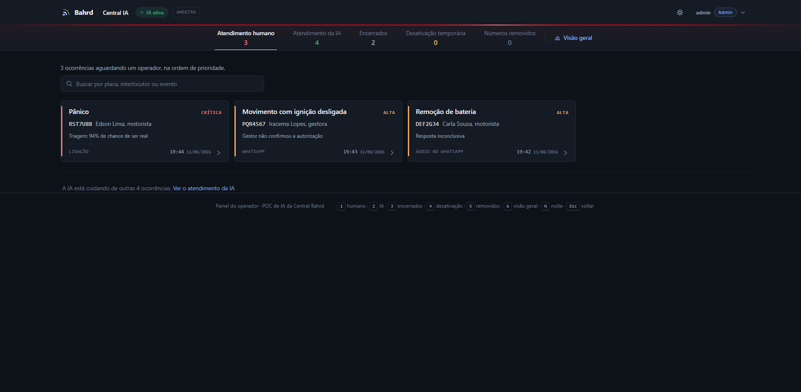 | 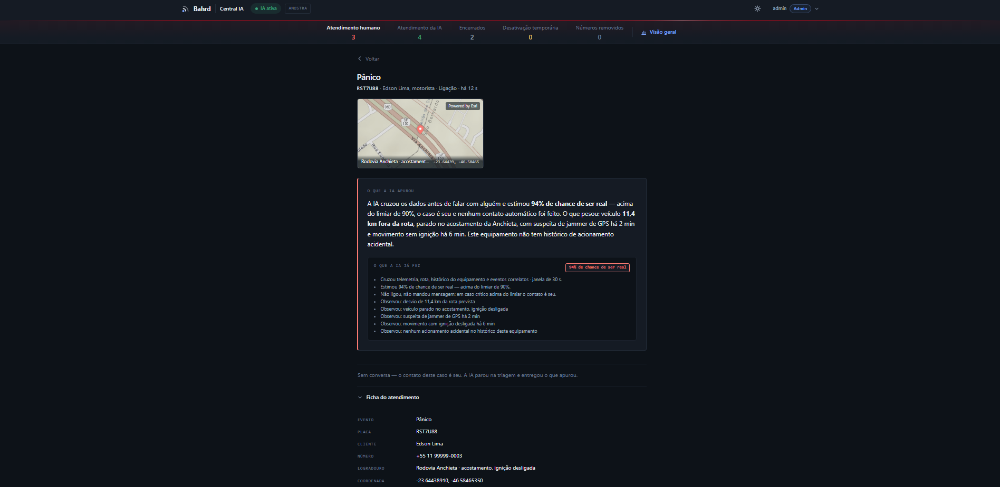 |
| **Atendimento humano.** Só o que precisa de uma pessoa, na ordem de prioridade, com busca. | **Triagem.** Pânico com 94% de chance de ser real: a IA não fala com ninguém e entrega o que apurou. |
| 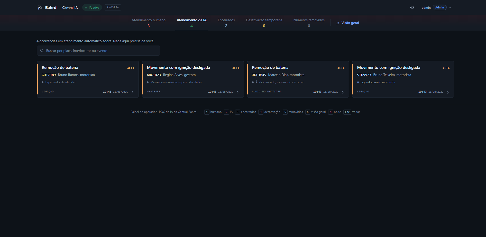 |  |
| **Atendimento da IA.** O que está em andamento, com o passo atual de cada caso. | **Conversa ao vivo.** A mesma conversa que o cliente vê no WhatsApp, com botões. |
| 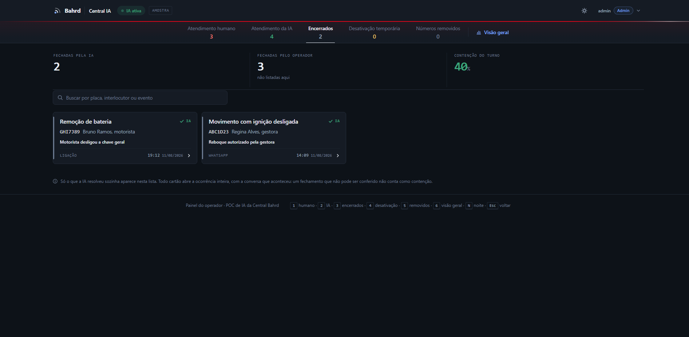 | 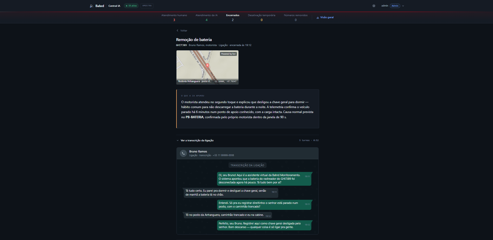 |
| **Encerrados.** O que a IA fechou sozinha, e a contenção do turno. | **Histórico.** Cada caso encerrado abre inteiro: resumo, mapa e transcrição. |
| 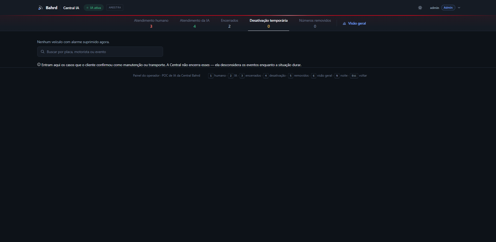 | 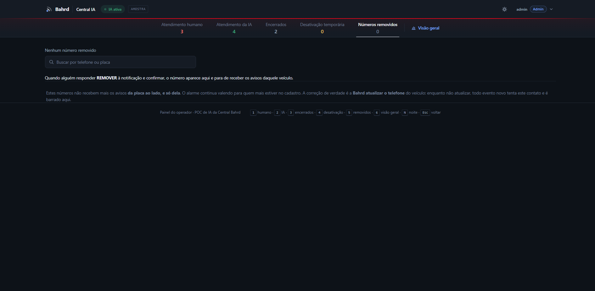 |
| **Desativação temporária.** Veículos em manutenção ou transporte, com o alarme suspenso. | **Números removidos.** Quem respondeu REMOVER deixa de receber os avisos daquela placa. |

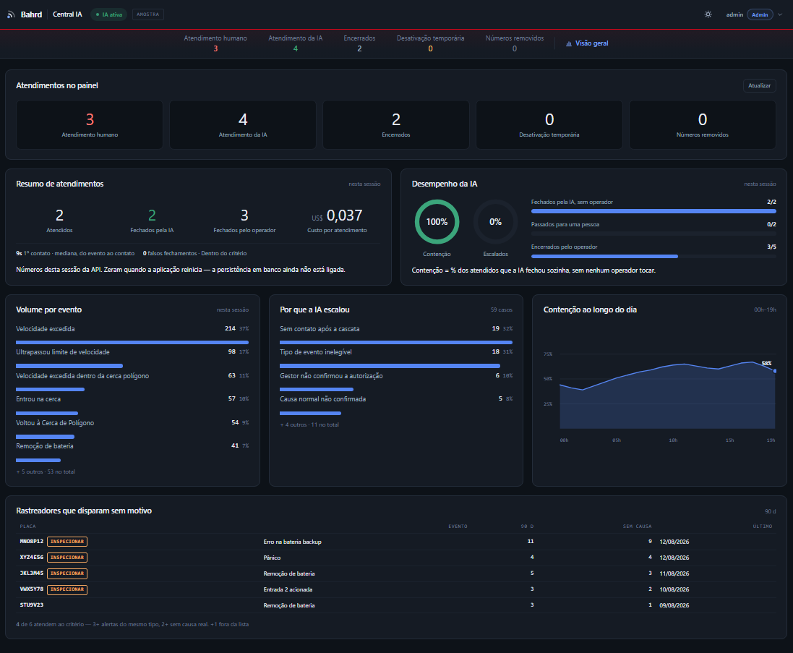

**Visão geral** (só para admin): o que está no painel, o desempenho da IA na
sessão, o volume por evento, por que a IA passou casos adiante, a contenção ao
longo do dia e os rastreadores que disparam sem motivo.

## URL pública

### **https://bahrd.duckdns.org**

O painel do operador pede login, com os perfis **admin** e **operador**. As
credenciais de teste vão na mensagem de entrega da disciplina, nunca neste
repositório. A API responde no mesmo domínio.

| | |
|---|---|
| **Produção** | [bahrd.duckdns.org](https://bahrd.duckdns.org) · versão `1.4.0` |
| **Desenvolvimento** | [bahrd-dev.duckdns.org](https://bahrd-dev.duckdns.org) · secrets próprios |
| **Onde roda** | Oracle Cloud, São Paulo, camada gratuita permanente ([ADR-002](docs/adr/0002-plataforma-de-publicacao.md)) |
| **TLS** | Let's Encrypt, emitido e renovado pelo Caddy |

### Janela de uptime

A aplicação ficou 25 horas no ar antes da entrega, de 05/11 01:22 a 06/11
02:26 (UTC), sem deploy no meio. Três provas, cada uma de uma fonte:

| Prova | Resultado |
|---|---|
| Verificação externa, a cada 5 minutos, nos dois ambientes | **600 de 600 ok**: API de pé, banco Oracle respondendo e versão `1.4.0` em todas ([log completo](docs/evidencias/uptime-2026-11-05.log)) |
| UptimeRobot, de servidores próprios, em `/saude/pronto` | **100% nas últimas 24h**, 0 incidentes ([página pública](https://stats.uptimerobot.com/T0wcfHdkAq)) |
| `docker ps` no servidor de produção | API, worker e web **26 horas no ar sem reiniciar**, na imagem do commit `3b25465` |

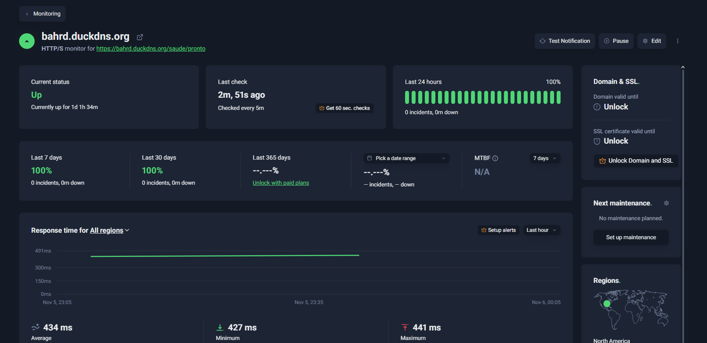

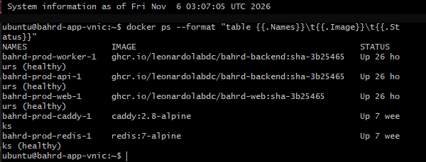

Método, tempos de resposta e a leitura de cada linha:
[docs/evidencias/uptime-2026-11-05.md](docs/evidencias/uptime-2026-11-05.md).

### Separação de ambientes

Não é só domínio diferente — cada camada tem sua própria credencial, e nenhuma
é compartilhada entre dev e produção:

| Camada | Produção | Desenvolvimento |
|---|---|---|
| Máquina | VM própria, IP próprio | VM própria, IP próprio |
| Deploy (SSH, token do painel) | [GitHub Environment](https://github.com/Leonardolabdc/bahrd-ia/settings/environments) `prod` | [GitHub Environment](https://github.com/Leonardolabdc/bahrd-ia/settings/environments) `dev` — secrets isolados, um não enxerga o outro |
| Oracle Autonomous Database | usuário `CENTRAL_IA`, schema próprio | usuário `CENTRAL_IA_DEV`, schema próprio (tabelas independentes, mesmas migrações) |
| MySQL HeatWave | usuário `bahrd`, schema `central_ia` | usuário `central_ia_dev`, schema `central_ia_dev` — sem permissão sobre o schema de produção |

Cada usuário de banco tem senha própria, nunca reaproveitada entre os dois
ambientes. Um bug em desenvolvimento não tem como escrever num dado de
produção — a credencial que a aplicação usa em dev simplesmente **não tem
acesso** às tabelas de produção, no nível do próprio banco, não só por
convenção de código.

> ⚠️ **Lacuna conhecida:** produção ainda conecta ao MySQL com `bahrd`, a
> conta administrativa da instância (a mesma usada para criar o usuário de
> dev), em vez de uma conta de aplicação com privilégio restrito só ao seu
> schema. Funciona e está isolado de dev, mas não segue o princípio de menor
> privilégio — fica registrado para a próxima iteração, mesmo padrão do
> Oracle (`CENTRAL_IA`, sem privilégio de DBA).

Sondas abertas, sem autenticação:

```bash
curl https://bahrd.duckdns.org/saude/vivo     # o processo e a versão no ar
curl https://bahrd.duckdns.org/saude/pronto   # Oracle, MySQL e Redis
```

E os três [smoke tests](tests/smoke/smoke.sh), que é como se confere de fora:

```bash
VERSAO_ESPERADA=1.4.0 ./tests/smoke/smoke.sh https://bahrd.duckdns.org
```

### Rollback

Uma VM não tem rollback de plataforma — não existe nada guardado além do que
[infra/deploy/rollback.sh](infra/deploy/rollback.sh) guarda. Testado ao vivo:
janela da esquerda mostra a versão caindo de `1.2.1` para `1.2.0` e voltando,
pedida de fora por `curl`; janela da direita é o script rodando, terminando em
37s com os três smoke tests passando sozinho no fim.

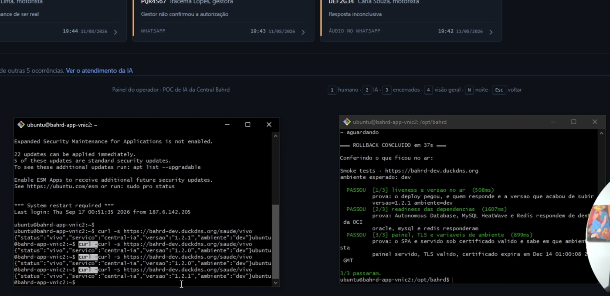

Log de outra execução, 33s: [docs/evidencias/rollback-2026-09-15.log](docs/evidencias/rollback-2026-09-15.log).

> **O painel pede login.** Dois perfis, admin e operador, com usuários
> definidos na configuração do servidor (`PAINEL_USUARIOS`), sem cadastro pela
> tela, e a conferência acontece na API em cada requisição. O operador atende
> as filas; a Visão geral e as telas de teste são do admin. A sessão vence
> depois de 12 h sem uso. Fechou a
> [lacuna 12 da auditoria](docs/auditoria-prototipo.md). O segredo da borda que
> protege `/painel/*` continua valendo junto: é injetado pelo Caddy no caminho
> servidor-a-servidor e **nunca chega ao navegador**. Em produção, sem usuário
> configurado, o painel fica fechado.

## Como rodar

Só precisa de **Docker**. Nada é instalado na máquina: Python, bancos, fila e
painel sobem em contêiner.

```bash
make setup     # cria o .env a partir do .env.example
make up        # sobe a pilha
make test      # a suíte inteira, sem tocar rede nem API paga
```

No Windows, o mesmo pelo PowerShell: `.\dev.ps1 setup`, `.\dev.ps1 up`,
`.\dev.ps1 test`.

Depois do `make up`:

| Onde | O quê |
|---|---|
| http://localhost:5173 | painel do operador |
| http://localhost:8000/docs | a API, com o OpenAPI navegável |
| http://localhost:16686 | Jaeger, os rastros de cada atendimento |

**Uma variável precisa de valor de verdade** antes de a IA falar:
`OPENROUTER_API_KEY` no `.env`. Sem ela a pilha sobe, os testes passam e a
conversa não acontece. O resto do `.env.example` já vem com valor de
desenvolvimento.

E antes do primeiro commit, uma vez:

```bash
git config core.hooksPath .githooks
```

É a trava que impede segredo e dado pessoal de entrarem por descuido. Ela é
local e **não vem no clone**, então cada pessoa liga a sua.

Detalhes de cada serviço e problemas conhecidos estão em
[04 · Ambiente Docker](docs/04-ambiente-docker.md).

## Arquitetura e stack

| Camada | O que roda |
|---|---|
| **Back-end** | Python 3.12 · FastAPI · Pydantic v2 · arq |
| **Front-end** | React 19 · TypeScript · Vite · CSS com design tokens |
| **Modelo** | Via OpenRouter, escolhido no painel: Gemini 2.5 Flash Lite (padrão, o mais barato), Gemini 2.5 Flash ou Claude Sonnet 5. O cache de prompt medido vale só para o Claude |
| **WhatsApp** | Twilio (sandbox) · adaptador para Cloud API da Meta disponível |
| **STT / TTS** | Deepgram Nova-3 · ElevenLabs Flash v2.5 |
| **Banco de registro** | Oracle 26ai (Blockchain Table) — Autonomous Database na OCI |
| **Banco operacional** | MySQL 8.4 em dev · MySQL HeatWave 26.7 na OCI |
| **Barramento / cache** | Redis 7 |
| **Observabilidade** | OpenTelemetry → Langfuse (um projeto por ambiente) · Jaeger na máquina local · logs estruturados · alerta por e-mail (Resend) |
| **Infraestrutura** | Docker Compose · 2× VM.Standard.E2.1.Micro (x86) na OCI |

```
bahrd-ia/
├── src/central_ia/        o código da aplicação
├── web/                   painel do operador (React + Vite)
├── tests/                 testes automatizados (ver Qualidade)
├── prompts/               os textos que definem como a IA fala
├── docs/                  arquitetura, custo e segurança
├── docker/                imagens e composição dos contêineres
├── infra/                 configuração de servidor e nuvem
├── migrations/            evolução do banco (Alembic)
└── .githooks/             trava de segredo, ativada com core.hooksPath
```

Dentro de `src/central_ia/`:

| Pasta | O que faz |
|---|---|
| **`domain/`** | as regras — catálogo de eventos, limiares, desfechos permitidos |
| **`agent/`** | a IA conversando — turno, triagem, blindagem, esforço |
| **`api/`** | rotas HTTP — webhooks, painel, saúde, mídia |
| **`integrations/`** | adaptadores — Meta, Twilio, OpenRouter, Anthropic, Deepgram |
| **`orchestration/`** | o pipeline: evento → política → IA → desfecho |
| **`ports/`** | os contratos — o que um LLM ou um canal precisa saber fazer |
| **`persistence/`** | banco de dados |
| **`workers/`** | tarefas em segundo plano — esperas e retomadas |
| **`observability/`** | logs estruturados e rastros |

**A regra que sustenta o desenho:** `domain/` não conhece ninguém. Ele define as
regras; `integrations/` implementa os contratos de `ports/`. É por isso que
trocar Twilio por Meta, ou um modelo por outro, foi variável de ambiente — não
reescrita.

## Qualidade

| | |
|---|---|
| **1107 testes** | Sem tocar rede, banco nem API paga. Toda dependência externa tem dublê. |
| **Lint** | `ruff` sobre `src`, `migrations` e `tests`. |
| **Varredura de segredo** | `gitleaks` sobre o **histórico**, não só o último commit. |
| **CI** | Os três acima rodam em todo push e pull request. |

A suíte foi construída contra conversas escritas como um motorista escreve —
com erro de digitação, caixa alta, gíria, mensagem picada, cliente irritado e
tentativa de injeção de prompt.

## Observabilidade

Instrumentado com [Langfuse](https://langfuse.com) — trace por ocorrência,
turno a turno, com custo e tokens ao lado. Dois projetos, um por ambiente,
nunca misturados: um teste em dev não contamina a métrica de produção.

| | |
|---|---|
| **Dashboard · produção** | [cloud.langfuse.com/project/cmv7c3sgg04bqad0esqwirp4d](https://us.cloud.langfuse.com/project/cmv7c3sgg04bqad0esqwirp4d) |
| **Dashboard · dev** | [cloud.langfuse.com/project/cmv7c40tw04bvad0ehm27s0da](https://us.cloud.langfuse.com/project/cmv7c40tw04bvad0ehm27s0da) |

**As 5 métricas essenciais de LLMOps**, as mesmas que o Langfuse já calcula
por trace:

| Métrica | O que mede | Por quê esse threshold |
|---|---|---|
| Latência (p50/p95/p99) | Tempo de resposta do turno | Percentil, nunca média — a média esconde o cliente que esperou 30s |
| Custo por execução | Tokens × preço do modelo | Direto da resposta do provedor, por turno |
| Taxa de erro | % de turnos que falharam | **Acima de 5% em 15 min dispara o alerta P2** abaixo |
| Volume | Turnos por minuto/hora | Queda súbita = app fora do ar; pico anormal = bot ou viralização |
| Qualidade | Modelo aprovado por medição real, não por confiança no fornecedor | Ver seletor de modelo no painel — `aprovado_para_producao` |

**Alerta configurado** — [`observability/alertas.py`](src/central_ia/observability/alertas.py):

| | |
|---|---|
| **O quê** | Taxa de erro de turnos acima de 5%, em janela de 15 min, amostra mínima de 10 turnos |
| **Prioridade** | P2 — degradação significativa, não sistema parado |
| **Público** | A operação |
| **Canal** | E-mail — de propósito, não WhatsApp (o número de teste já serve para a conversa com a IA; misturar aviso de sistema ali confundiria os dois papéis) |
| **Cooldown** | 1h — sem isso, cada turno que mantém a taxa alta manda um e-mail novo |

## LGPD

Detalhado em [docs/mapa-dados-pessoais.md](docs/mapa-dados-pessoais.md),
[docs/retencao-e-exclusao.md](docs/retencao-e-exclusao.md) e
[docs/rotacao-de-credenciais.md](docs/rotacao-de-credenciais.md). Resumo:

| | |
|---|---|
| **Base legal** | Execução de contrato — nenhum ponto de coleta usa consentimento. Ninguém clica em "aceito" antes de reportar que a bateria do veículo foi removida |
| **PII antes do LLM** | Nome, placa e endereço viram apelido fixo antes de qualquer chamada ao modelo, e voltam ao valor real só depois — [`pseudonimizacao.py`](src/central_ia/agent/pseudonimizacao.py). CPF, telefone de terceiro e e-mail soltos na conversa viram marcador, nunca chegam crus |
| **Transferência internacional** | Toda chamada de LLM é transferência — documentada por integração, base: execução de contrato |
| **Retenção** | 90 dias para a transcrição crua (MySQL), expurgo automático diário. Resumo e desfecho (Oracle) ficam como auditoria de longo prazo |
| **Rotação de credenciais** | Procedimento documentado, com evidência real de execução — não simulada |

## Otimização medida

**Cache de prompt na OpenRouter**, para o modelo `anthropic/claude-sonnet-5`
(o único prefixo que ativa `cache_control` — ver `integrations/llm/openrouter.py::_sistema`).
Medido de verdade, duas chamadas reais e consecutivas, mesmo prompt de sistema:

| | Chamada 1 (sem cache) | Chamada 2 (cache lido) |
|---|---|---|
| Tokens de entrada | 17.492 | 17.492 |
| Tokens lidos do cache | 0 | 17.477 |
| Custo | US$ 0,0705 | US$ 0,0040 |

**Economia: 94,3%** na segunda chamada em diante — e é exatamente o padrão de
uma conversa real: o *playbook* e a persona (o grosso do prompt de sistema)
não mudam turno a turno, só a conversa cresce.

*Trade-off, com honestidade*: a primeira chamada de cada conversa nova paga o
preço cheio — é ela que escreve o cache. O ganho aparece a partir do segundo
turno, e cresce com o tamanho da conversa. Latência não muda de forma
perceptível; o ganho é só de custo.

## Troubleshooting

Problemas reais, já enfrentados neste projeto — não hipotéticos.

| Sintoma | Causa | Solução |
|---|---|---|
| `docker compose restart` não aplica uma variável nova do `.env.prod` | `restart` reinicia o processo com o ambiente **antigo** — não relê o arquivo | Use `up -d <serviço>`, que recria o container com o ambiente atual |
| `API inacessível em http://localhost:8000` | A porta 8000 não é publicada para o host — só existe na rede interna dos containers | `docker exec $(docker compose ps -q api) curl http://127.0.0.1:8000/saude/vivo` |
| `401` em `/painel/fila` | O token do painel não está em `config.js` **de propósito** (publicá-lo ali vazaria o segredo para qualquer visitante) | O Caddy injeta o token servidor-a-servidor; confirme que está acessando pelo domínio público, não por IP direto |
| Build quebra sozinho, sem ninguém ter mexido no código | Dependência sem teto de versão (`>=`) pegou um release novo que quebrou algo interno — já aconteceu com PyMySQL e com o OpenTelemetry | Travar a versão exata no `pyproject.toml` — ver [Post-mortem 03](docs/post-mortem-03-dependencia-sem-teto.md) |
| `ORA-05807` ao conectar no Oracle | Autonomous Database Always Free limita a retenção de inatividade a 16 dias; o projeto pedia 31 | Ajustar a expectativa para 16 dias — é limite da camada gratuita, não bug |
| Smoke test acusa ambiente errado depois de um rollback | `rollback.sh` chamava o smoke test sem dizer qual ambiente esperar, e o padrão do script é `prd-poc` | Corrigido — lê `APP_ENV` do próprio `.env.prod` da máquina |
| Colar no terminal produz `^[[200~` no início da linha | Colagem por botão direito do mouse, em vez de atalho — o modo de colagem em blocos (*bracketed paste*) vaza como texto | Cole com `Shift+Insert` |

## Documentação

| Documento | Conteúdo |
|---|---|
| **[02 · Plano de execução](docs/02-plano-execucao-backend.md)** | Decisões de arquitetura e a justificativa de cada uma, estratégia Docker-first, modelo de dados, guardrails, front-end e roadmap |
| **[04 · Ambiente Docker](docs/04-ambiente-docker.md)** | Como subir a pilha local, as decisões não óbvias (sondas de saúde, migrações) e os problemas conhecidos |
| **[05 · Deploy](docs/05-deploy-oci.md)** | Publicação da imagem, variáveis por ambiente, sequência de deploy e rollback |
| **[06 · Custo mensal](docs/06-custo-mensal.md)** | Projeção por serviço, com o grau de confiança de cada linha, e a comparação com os ~R$ 4.000/mês da URA atual |
| **[07 · Segurança](docs/07-seguranca.md)** | O que já está protegido, o que fica para depois com o gatilho de cada item, e o que decidimos **não** fazer |
| **[08 · Runbook de deploy](docs/08-runbook-deploy.md)** | Do zero ao ar: DNS, firewall, wallet, primeiro deploy, CD e ensaio de rollback |
| **[Auditoria do protótipo](docs/auditoria-prototipo.md)** | As 14 lacunas encontradas antes de mexer, com o comando que revelou cada uma |
| **[Matriz de decisão](docs/decisao-stack.md)** | Critérios, pesos e notas — os pesos fixados um dia antes das notas |
| **[ADR-001](docs/adr/0001-stack.md)** · **[ADR-002](docs/adr/0002-plataforma-de-publicacao.md)** | Manter a stack herdada · publicar na Oracle Cloud |
| **[C4 · nível 1](docs/architecture/c4-nivel-1-contexto.md)** · **[nível 2](docs/architecture/c4-nivel-2-containers.md)** | Contexto e contêineres |
| **[Post-mortem 01](docs/post-mortem-01-pii-no-historico.md)** | Dado pessoal no histórico do Git: causa raiz e o que mudou |
| **[Post-mortem 02](docs/post-mortem-02-primeiro-deploy.md)** | O primeiro deploy e os dez defeitos que ele revelou — todos invisíveis em desenvolvimento |
| **[Post-mortem 03](docs/post-mortem-03-dependencia-sem-teto.md)** | Leve, uma página — dependência sem teto de versão quebrou o MySQL sozinha, sem nenhum código tocado |
| **[CHANGELOG](CHANGELOG.md)** | O que mudou em cada versão |

## Configuração que muda por ambiente

Nenhuma é código, e todas são fáceis de esquecer justo no dia em que mais
importam.

| Variável | Efeito |
|---|---|
| `BAHRD_WEBHOOK_HMAC_SECRET` | Sem um segredo real, qualquer um forja um evento. |
| `ESCALONAMENTO_HUMANO_ATIVO` | Com `false`, a IA encerra tudo registrando o motivo pelo qual teria escalado. |
| `PANICO_AUTONOMO` | Permite à IA encerrar sozinha um pânico que ela classificou como alarme falso. |
| `LANGFUSE_ENVIAR_CONTEUDO` | Com `true`, conteúdo de conversa sai para a nuvem de observabilidade. |

O valor de desenvolvimento do HMAC se chama `dev-hmac-nao-usar-em-producao`
justamente para não passar despercebido numa revisão.

## Limitações conhecidas

**Funciona ponta a ponta, com evento sintético e celular de verdade:**

```
evento → template com mapa → botões → conversa → desfecho → painel
```

O que ainda não funciona, ou funciona com ressalva:

| Limitação | Por quê | Consequência |
|---|---|---|
| **Sem rastreador real** | Não há acesso ao sistema de rastreamento de uma frota de verdade. Os eventos entram pelo painel de testes (só em dev) ou pelo webhook com payload sintético | O selo **Amostra** aparece no cabeçalho, e parte da Visão geral (contenção de 58%, 1º contato, falsos fechamentos) é número de exemplo fixo |
| **Ocorrência e conversa não vão para o banco** | Oracle e MySQL sobem e respondem à sonda, mas nenhum código grava neles ainda | Encerrados e números da Visão geral zeram quando a API reinicia. O expurgo de 90 dias roda todo dia, mas sobre tabelas vazias |
| **Curva de contenção** | Sem nenhum caso real no dia, a tela mantém a curva de amostra em vez de ficar vazia | Hora com caso real usa o número real; hora sem caso nunca vira 0% |
| **Login com dois perfis, usuários definidos na configuração** | Fecha a [lacuna 12](docs/auditoria-prototipo.md). Não há cadastro pela tela nem troca de senha pela tela | Criar, remover ou trocar a senha de alguém é gerar a entrada com `scripts/criar_usuario_painel.py`, editar `PAINEL_USUARIOS` no servidor e reiniciar a API |
| **Assinatura do webhook sem segredo** | A conferência HMAC-SHA256 está implementada, mas o segredo ainda não foi combinado com quem envia o evento ([lacuna 4](docs/auditoria-prototipo.md)) | Sem o segredo, o webhook aceita o evento e avisa no log. Não há como provar que ele veio do rastreador |
| **MySQL de produção com conta administrativa** | A conta de aplicação com privilégio mínimo ainda não foi criada | Isolado de dev, mas fora do princípio de menor privilégio |
| **Nome de terceiro em texto livre** | A sanitização troca nome, placa e endereço cadastrados e barra CPF, telefone e e-mail, mas não reconhece um nome solto na frase | Risco residual registrado em [docs/mapa-dados-pessoais.md](docs/mapa-dados-pessoais.md) |
| **Cache de prompt só com Claude** | Só o prefixo `anthropic/` recebe `cache_control` | Os 94,3% de economia valem quando o modelo escolhido é o Claude Sonnet 5, não com o Gemini padrão |
| **Alerta por e-mail de teste** | O remetente é o `onboarding@resend.dev`, de testes, sem domínio próprio verificado | Serve para a POC: só entrega para o e-mail dono da conta do Resend |
| **Sem alta disponibilidade** | Uma VM gratuita de 1 GB por ambiente | Se a VM de produção cair, o sistema cai junto. O rollback cobre deploy ruim, não queda de máquina |
| **Voz por telefone** | Sem provedor de telefonia definido | O canal de ligação existe no domínio e nos testes, não no ar |

---

## Sobre este repositório

Projeto acadêmico da disciplina **AI Factory: Build, Deploy and Showcase**
(PUCPR).

**A Bahrd Monitoramento é uma empresa fictícia**, assim como a Vetor,
fornecedora da URA legada citada na documentação. Os volumes, playbooks e
decisões de negócio descritos aqui compõem um cenário construído para o
trabalho — não descrevem nenhuma operação real.

**Todo dado neste repositório é fictício**, e isso vale para cada categoria:

| | |
|---|---|
| Telefones | dígitos repetidos (`+55 41 99999-8888`) |
| Placas | padrão de exemplo (`ABC1D23`, `XYZ4E56`) |
| Nomes | genéricos, sem correspondência com pessoas |
| Endereços e coordenadas | logradouros inventados |
| IMEIs de rastreador | sequência sintética (`8602000000000xx`) |
| Identificadores de conta | sequência sintética, não resolvem em lugar nenhum |

Isso não depende de disciplina: o teste
**`test_nada_de_dado_real_no_repositorio`** falha a suíte inteira se um dado
que pareça real entrar, e o `gitleaks` varre o histórico em todo push.

Licença em [LICENSE](LICENSE) · como contribuir em
[CONTRIBUTING.md](CONTRIBUTING.md) · política de segurança em
[SECURITY.md](SECURITY.md).

