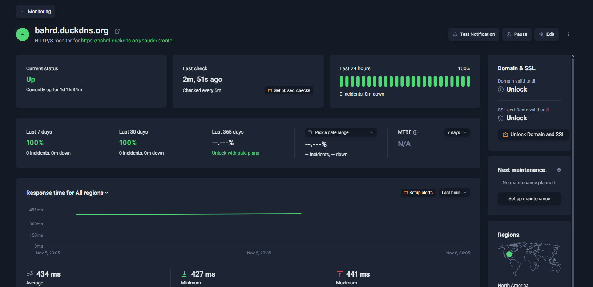
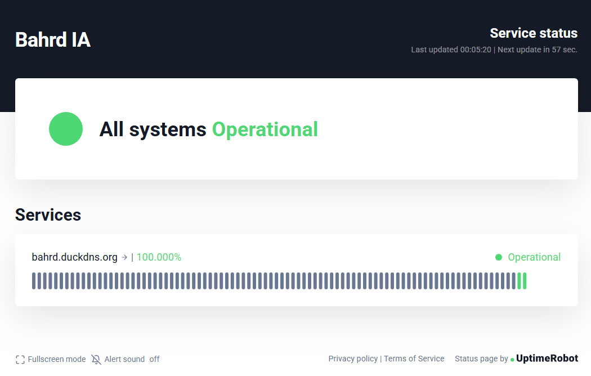
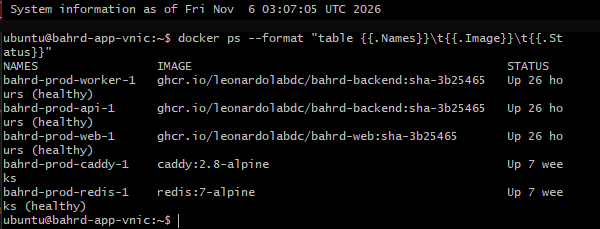

# Janela de uptime · 05/11/2026

A Etapa 3 pede a aplicação no ar por 24 horas antes da avaliação, com a janela
documentada. Esta é a janela, medida de três formas que não dependem uma da
outra.

## Resultado

| | Produção | Desenvolvimento |
|---|---|---|
| URL | https://bahrd.duckdns.org | https://bahrd-dev.duckdns.org |
| Início | 05/11 01:22:56 UTC (04/11 22:22, Brasília) | igual |
| Fim | 06/11 02:26:16 UTC (05/11 23:26, Brasília) | igual |
| Duração | **25 h 03 min** | **25 h 03 min** |
| Verificações | 300, uma a cada 5 min | 300, uma a cada 5 min |
| Falhas | **0** | **0** |
| No ar | **100%** | **100%** |
| Versão respondida | 1.4.0 em todas | 1.4.0 em todas |
| Tempo médio | 0,10 s | 0,10 s |
| Pior tempo | 5,65 s (05/11 06:59 UTC), com resposta correta | 2,00 s (05/11 13:16 UTC), com resposta correta |
| Maior intervalo entre verificações | 5 min 14 s | 5 min 14 s |

Nenhum deploy aconteceu dentro da janela. O último foi o da 1.4.0, em 05/11 às
01:09 UTC, pelo CD do GitHub Actions (commit `3b25465`), 14 minutos antes da
primeira verificação.

## 1 · Verificação externa a cada 5 minutos

Arquivo: [`uptime-2026-11-05.log`](uptime-2026-11-05.log)

Um script rodou fora da nuvem, num computador comum, consultando os dois
ambientes a cada 5 minutos, 300 vezes. Cada linha registra:

```
horario_utc  ambiente  http_vivo  versao  http_pronto  oracle  tempo_s
```

- `http_vivo`: resposta de `GET /saude/vivo`, que diz se a API está de pé.
- `versao`: a versão que a API informa. Se mudasse no meio, teria havido deploy.
- `http_pronto` e `oracle`: resposta de `GET /saude/pronto`, que só dá 200 se
  as dependências respondem, incluindo o Oracle Autonomous Database.
- `tempo_s`: tempo total da consulta, contado do lado de quem consulta.

A verificação conta como ok só quando as duas rotas respondem 200 e o Oracle
responde `ok`. Foram 600 verificações, todas ok.

O tempo inclui a internet residencial de quem consultou. Os dois picos (5,65 s
e 2,00 s) foram consultas isoladas, e a seguinte voltou ao normal.

## 2 · Monitor independente: UptimeRobot

Página pública: https://stats.uptimerobot.com/T0wcfHdkAq

O UptimeRobot consulta `https://bahrd.duckdns.org/saude/pronto` a cada 5
minutos, de servidores próprios. É uma segunda fonte, que não passa pelo
computador do script acima, e consulta a mesma rota que exige o Oracle de pé.
Ele monitora só a produção; o desenvolvimento ficou só na verificação do item 1.

Painel do monitor, em 06/11 às 00:05 de Brasília: **Last 24 hours 100%, 0
incidents, 0m down**, e no ar há 1 dia, 1 hora e 34 minutos sem interrupção.



Página pública de status, no mesmo momento:



## 3 · Os containers no servidor de produção

Saída de `docker ps` no servidor de produção, em 06/11 às 03:07 UTC, depois do
fim da janela:

```
NAMES                 IMAGE                                             STATUS
bahrd-prod-worker-1   ghcr.io/leonardolabdc/bahrd-backend:sha-3b25465   Up 26 hours (healthy)
bahrd-prod-api-1      ghcr.io/leonardolabdc/bahrd-backend:sha-3b25465   Up 26 hours (healthy)
bahrd-prod-web-1      ghcr.io/leonardolabdc/bahrd-web:sha-3b25465       Up 26 hours (healthy)
bahrd-prod-caddy-1    caddy:2.8-alpine                                  Up 7 weeks
bahrd-prod-redis-1    redis:7-alpine                                    Up 7 weeks (healthy)
```



API, worker e web estão de pé há 26 horas, sem reiniciar, na imagem do commit
`3b25465`. Isso fecha com o deploy das 01:09 UTC de 05/11. O Caddy e o Redis não
são recriados pelo deploy e estão no ar há 7 semanas.

## O que manteve o banco ativo

O Oracle Autonomous Database do plano gratuito para sozinho depois de 7 dias sem
conexão. Um agendamento no servidor de produção consulta `/saude/pronto` a cada
6 horas, e isso conta como uso do banco. Ele já rodava antes da janela e
continua rodando.
